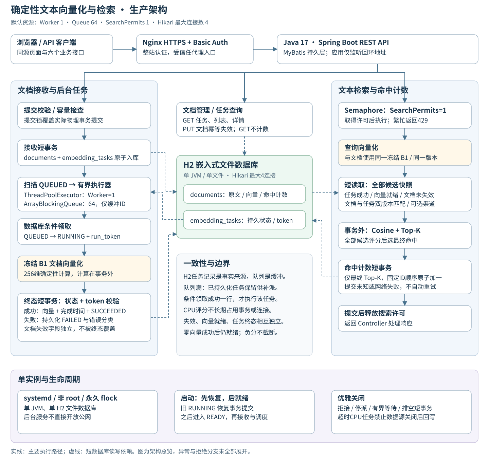
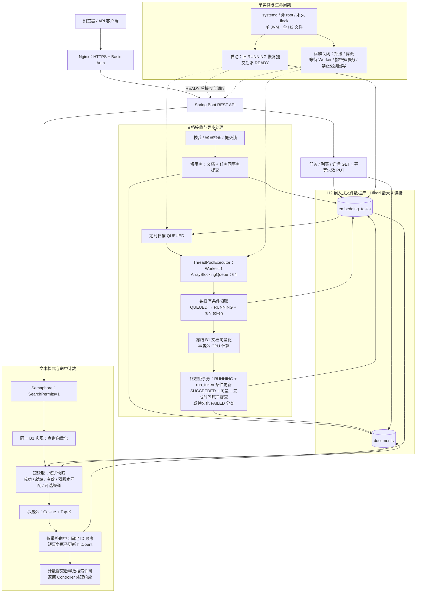

# 文本向量化与检索

一个基于 Java 17 的文本检索项目，覆盖文档接收、异步向量化、持久任务恢复、相似度检索和命中计数，提供 REST API 与原生 Web 演示台。

项目使用**确定性的字面特征向量算法**，适合演示文本特征提取和检索工程设计；不调用外部模型，不使用大模型语义 Embedding，也不将相似度解释为语义准确率。

**[查看设计思路](docs/DESIGN.md) | [查看使用说明](docs/USER-GUIDE.md) | [查看AI关键对话](docs/AI-COLLABORATION.md)**

## 📚 项目文档与交付导航

| 文档 | 内容简介 |
| --- | --- |
| [系统设计与技术选型](docs/DESIGN.md) | 架构、算法、任务调度、事务一致性及技术取舍 |
| [项目使用说明](docs/USER-GUIDE.md) | 环境配置、服务启动、页面操作与API示例 |
| [AI协作与关键对话](docs/AI-COLLABORATION.md) | 真实需求讨论、AI建议、人工决策和工程实践 |
| [项目交付资料](docs/DELIVERY.md) | 测试、部署、版本和技术成果 |
| [完整文档目录](docs/README.md) | 详细设计契约、测试报告和历史记录 |

当前上线版本为`2764edd`，对应发布构建的282项自动化测试通过。版本、部署记录及详细验证范围见[测试与质量验证](docs/testing/UI-RELEASE-verification.md)。

## 技术栈

| 层次 | 技术 |
| --- | --- |
| 后端 | Java 17、Spring Boot 4.0.3、MyBatis Spring Boot Starter 4.0.1 |
| 存储 | H2 2.4.240，嵌入式文件模式、单 JVM 单实例 |
| 前端 | 原生 HTML / CSS / JavaScript，与后端同源，无前端构建依赖 |
| 构建与测试 | Maven Wrapper / Maven 3.9.9、JUnit、Surefire / Failsafe、Node.js 22.16.0 内置测试运行器 |
| 部署 | Ubuntu、Nginx、systemd、HTTPS 与入口认证 |

## 主要功能

- **文档接收与异步处理**：校验 ID、文本及渠道，文档和任务同事务持久化，返回任务 ID；后台计算真实向量。
- **任务与文档管理**：查询任务状态、分页列表和完整原文详情；文档可主动失效，重复失效保持首次时间。
- **相似检索**：查询文本使用同一算法，支持渠道过滤和 Top-K；返回余弦分数及纯文本摘要。
- **命中计数**：仅最终命中的文档原子加一；列表、详情和任务 GET 不计数。
- **持久化与恢复**：文件数据库保存任务和向量；支持启动恢复、优雅关闭，以及已在隔离环境验证的独立进程强杀恢复。

六个业务接口及错误码见 [API v1.0 契约](docs/api/api-contract.md)。检索请求会更新命中计数，属于有副作用操作；网络失败或提交结果未知时不自动重试。

## 核心技术设计

1. **256 维确定性向量**：NFKC、`Locale.ROOT` 小写及 Unicode 空白规范化后，按 code point 提取字符 1-gram / 2-gram，使用带符号 SHA-256 映射和固定顺序 L2 归一化。同文在约定 Java 17 基线下按位一致；空文得到零向量。codec 固定为 BIG_ENDIAN 的 1,024 字节，算法与持久层解耦。[算法契约](docs/design/b1-algorithm-contract.md)
2. **候选快照与 Top-K**：先筛选任务成功、向量就绪、未失效、文档与任务算法版本均匹配的候选，再做完整评分。小顶堆选取 Top-K，按分数降序、同分按 ID 升序，保留零分和负分。CPU 评分不持有数据库事务或连接。
3. **有界执行与可靠调度**：H2 任务表是事实来源，`ThreadPoolExecutor` 和有界队列仅作缓冲。条件更新领取任务；队列满时，已持久化任务仍由扫描补派。提交锁覆盖物理事务提交，计算在事务外，向量、完成时间与成功终态同一短事务写入。[B3 事务与恢复设计](docs/design/b3-implementation-contract.md)
4. **竞态与生命周期**：终态更新必须匹配 `RUNNING + run_token`，防止迟到结果覆盖；文档失效与任务状态独立。启动先完成旧任务恢复再接受业务；关闭先拒接、停派、等待并排空短事务，超时 CPU 任务不得在数据源销毁后回写。
5. **计数与资源边界**：所有候选评分和 Top-K 完成后，才按固定 ID 顺序对最终命中执行短事务原子自增。默认 Worker 1、队列 64、搜索许可 1、连接池 4、最多 5,000 篇文档。单实例约束与非覆盖冷备、独立恢复已验收；这些参数不是 QPS 或 SLA 承诺。[运行与资源契约](docs/design/runtime-contract.md)

## 系统架构

生产默认 Worker=1、Queue=64、SearchPermits=1、Hikari 最大连接数=4。H2 任务表负责可靠持久化，内存队列只保存待执行任务 ID；两条 CPU 计算路径都不长期持有数据库事务。



静态总览随仓库保存，可直接打开大图；下方保留 GitHub 原生 Mermaid，便于查看主要依赖和维护源文本。

<details>
<summary>展开原生 Mermaid 架构图</summary>



</details>

图中数据库箭头表示读取或写入依赖；GET 不增加命中计数，文档失效与任务终态独立。正式实例的 Worker 与搜索许可不会因本轮测试而修改。

## 并发设计与线程安全

提交锁覆盖文档和任务的物理事务提交；后台仅在条件领取成功后计算，终态由 `RUNNING + run_token` 约束。搜索许可覆盖计算至命中计数提交，CPU 阶段不占数据库连接；计数使用原子更新，文档失效字段独立维护。HTTP 客户端并发与后台 Worker 并发分别观测。

本轮正式环境核证了重复 ID 竞争、搜索与失效竞态、149 次成功搜索对应的精确计数增量，以及单 Worker 的真实 CPU 活动。Worker=2/4、队列饱和和故障注入没有在本轮执行，详见[Java 多线程并发报告](docs/testing/CONCURRENCY-REPORT.md)。

## 性能测试与基线

以下为首发d016包的历史基线，不是当前前端版本的性能复测。2026-10-23 在固定生产 JAR、真实 HTTPS 与认证下完成一次有界 1/2/4/8 客户端阶梯：每阶测量 27 秒、最多 3 秒收尾，总请求跨度 117.818 秒。搜索固定 N=9、Top-K=1、查询 12,000 code points；详情、列表和搜索混合请求，另稀疏提交 4 篇。

| 客户端并发 | 混合成功 QPS | 成功响应 p95 / p99（ms） | 429（含尾部） |
| --- | --- | --- | --- |
| 1 | 2.889 | 495.10 / 509.82 | 0 |
| 2 | 3.741 | 777.90 / 909.38 | 1 |
| 4 | 6.296 | 1269.00 / 1281.56 | 17 |
| 8 | 7.852 | 1589.20 / 2828.66 | 39 |

631 次请求中，570 次 HTTP 200、4 次接收成功 202、57 次搜索保护 429；未知结果和 5xx 均为 0。QPS 只计测量窗内完成的业务成功，延迟与上表 429 保留窗口内发起、宽限期完成的尾请求；202 不等于向量化完成。该成绩是短窗、小候选集、长查询的混合负载基线，**不是最大容量或 SLA**。

本轮新增 17/20 篇，原有 9 篇的元信息和计数保持不变；Chrome 已完成提交、真实任务终态、列表、搜索计数和失效闭环。Worker=2/4、N=100/1000/5000 及隔离环境最大吞吐仍未执行，连接池精确占用与 GC 单次暂停未测量。

公开报告：[线上功能与 70 条分层映射](docs/testing/ONLINE-FUNCTIONAL-REPORT.md) · [并发与一致性](docs/testing/CONCURRENCY-REPORT.md) · [QPS、资源图表及复核方法](docs/testing/PERFORMANCE-BASELINE.md)。本轮 39 个线上功能声明场景与历史 273 项自动化、70 条主验收采用不同统计维度，不相加，也不将历史 70 条全部标为本轮线上通过。

## 在线演示

**[https://text-vector-search.lemoncharger.com](https://text-vector-search.lemoncharger.com)**

演示环境使用 HTTPS，页面和 API 均需要入口认证。请通过授权渠道获取访问凭据，公开仓库不提供账号密码。演示服务使用下方固定发布版本。FINAL-QUALITY性能报告对应此前原JAR；本次已实际发布前端改版，不将旧版性能数据当作新版复测成绩。

<details>
<summary>固定发布版本与验收 CI</summary>

- 当前应用源码：`2764eddf34418fdcc8ed666e36937673c7feadb8`。
- 当前JAR SHA-256：`b8b67460ee6af26ec5ea7854377b63919c18c37760b11e3fbf49f7672be7f45f`。
- 当前发布：[CI39915764822](https://github.com/Qbsstg/text-vector-search/actions/runs/39915764822)，282项自动化及实际新JAR的Linux冷备/恢复/锁检查成功。
- 后续缓存模板同步：[CI39921238979](https://github.com/Qbsstg/text-vector-search/actions/runs/39921238979)，受测`a4be0aa`；不替换当前固定JAR。
- 首发/后端字节冻结及代码回退基线：`d016d6e8bb431ff17ba81f8977d31a1b96f51f7f` / `64bc9c0ba187b6779622a7ddab5beb4b50152424e3926c55b76249c98b609b50`。
- 原批准产物：[CI39838054946](https://github.com/Qbsstg/text-vector-search/actions/runs/39838054946)。
- 首发最终交付回归：[CI39891645582](https://github.com/Qbsstg/text-vector-search/actions/runs/39891645582)，受测提交 `661ed08c1f524358111881e9c4e1fe1936a7a4a5`，273 项通过，并核对原批准 JAR。文档提交不替换生产版本。

</details>

## 本地运行

要求 **JDK 17**，将 `JAVA_HOME` 和 `PATH` 指向该 JDK；构建会拒绝其他 Java 主版本。Node.js 22.16.0 仅用于前端测试，运行应用无需 Node 或前端打包。

```bash
git clone https://github.com/Qbsstg/text-vector-search.git
cd text-vector-search
java -version
./mvnw -version
./mvnw -B -ntp clean verify
node --test tests/frontend/*.test.mjs
```

首次构建需要下载 Maven 和依赖。macOS 可先执行 `export JAVA_HOME=$(/usr/libexec/java_home -v 17)` 选择 JDK；其他系统使用实际的 JDK 17 安装位置。

启动本地应用：

```bash
mkdir -p .local-data
APP_DATA_DIR="$PWD/.local-data" java -jar target/vector-search.jar
```

打开 [本地演示台](http://127.0.0.1:8080/)，[本地健康检查](http://127.0.0.1:8080/health) 在真实业务就绪时返回 200，未就绪返回 503。同一数据目录只能由一个实例打开；需要退出时使用正常停止，不在活动数据库上直接复制备份。这里的 `.local-data` 是本地示例目录，与正式环境数据无关。

`clean verify` 同时执行 Surefire 的 `*Test` 和 Failsafe 的 `*IT`；报告分别在 `target/surefire-reports/`、`target/failsafe-reports/`。前端测试通过 Node 内置运行器单独执行。

## 测试与验收

以下是既有 FINAL-RELEASE 交付结果；本轮新增线上实测单独列在上述性能摘要和三份报告中，不改写历史结果。

| 统计维度 | 已核证结果 |
| --- | --- |
| 自动化 | 104 Unit + 126 IT + 43 Node = **273 项通过**，失败、错误、跳过均为 0 |
| 本地主验收 | **70 项通过**，采用最新批准判据；属于需求映射，不与 273 相加 |
| 原 UI 验收 | **28 项 PASS**；F05 为 `NOT_RUN / APPROVED_EXCEPTION`，不计为测试通过 |
| 正式集成 | HTTPS 认证、六接口、真实 Chrome 闭环、重启持久化、冷备及独立恢复已有实测记录 |
| 版本兼容判据 | REC-07-R1 独立实测通过；原 REC-07 预期与历史 FAIL 保留，未改写为 PASS |

覆盖确定性黄金向量、独立 JVM、codec、余弦与 Top-K oracle，以及真实 H2 事务、并发竞态、条件领取、终态、关闭和进程恢复。语义准确率、无限长期负载与 SLA 没有验收承诺；首发没有已验旧版，未伪称执行旧版回滚。

## 深入阅读与历史记录

完整分类说明见[项目文档目录](docs/README.md)。下列文件用于深入追溯，不是首次阅读的必经路径。

| 资料内容 | 公开文档 |
| --- | --- |
| 项目成果、版本与交付资料 | [项目交付资料](docs/DELIVERY.md) |
| 最终结论、版本与未执行边界 | [最终交付聚合结果](docs/testing/最终交付聚合结果.md) |
| 六接口、校验与错误码 | [API 契约](docs/api/api-contract.md) |
| 算法、codec、余弦与堆排序 | [B1 算法设计](docs/design/b1-algorithm-contract.md) |
| 启停、持久化与容量约束 | [运行与资源契约](docs/design/runtime-contract.md) |
| 分阶段工程验收（历史） | [B1](docs/testing/B1-verification.md) · [B2](docs/testing/B2-verification.md) · [B3](docs/testing/B3-verification.md) · [B4](docs/testing/B4-verification.md) |
| 原 UI 结果与批准例外 | [Chrome 历史验收](docs/testing/UI-browser-verification.md) · [F05 例外说明](docs/testing/F05-例外申请.md) |
| 70 条来源映射与判据修订 | [历史用例矩阵](docs/testing/final-release-local-cases-matrix.md) · [REC-07-R1 实测](docs/testing/REC-07-修订验收.md) |

历史报告顶部已注明阶段范围。完整服务器操作交接、受限原始证据与用户本地材料不作为公开下载内容；聚合结论不替代原件。仓库保持 PUBLIC，已有测试证据和 Git 历史保留。
