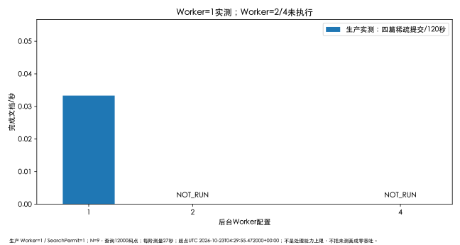

# Java 多线程并发与一致性测试报告（FINAL-QUALITY）

2026-10-23 在固定正式JAR、Worker=1 / Queue=64 / SearchPermits=1 / Hikari=4下完成有限并发提交、重复ID、搜索计数和检索/失效竞态，并观测真实线程活动。**本轮证明的是默认配置下已执行场景的一致性与保护行为，不是Worker=2/4扩容收益，也没有在生产强杀或制造数据库故障。**

生产源码与JAR摘要、时间窗、完整QPS/资源口径见[性能基线](PERFORMANCE-BASELINE.md)；39功能场景及70条分层映射见[线上功能报告](ONLINE-FUNCTIONAL-REPORT.md)。旧273项和已验70条不能算本轮新并发执行数。

## 实现与线程边界

- [TaskDispatcher](../../src/main/java/dev/twelvetimes/vector/task/TaskDispatcher.java) 使用固定大小 `ThreadPoolExecutor`、`ArrayBlockingQueue(64)`、`AbortPolicy` 和本地inFlight集合。Runnable只携带任务ID；拒绝入队后保留H2 QUEUED供下次扫描。
- [TaskClaimService](../../src/main/java/dev/twelvetimes/vector/task/TaskClaimService.java) 依赖数据库条件领取；[TaskTerminalService](../../src/main/java/dev/twelvetimes/vector/task/TaskTerminalService.java) 以RUNNING+run_token限制终态，防止旧执行者覆盖。计算在事务外，向量和SUCCEEDED终态短事务提交。
- [SearchService](../../src/main/java/dev/twelvetimes/vector/search/SearchService.java) `Semaphore.tryAcquire()`保护从查询向量化到计数提交；未取得返回429 SEARCH_BUSY。候选读取完成后释放数据库连接再评分/Top-K；[SearchHitCountService](../../src/main/java/dev/twelvetimes/vector/search/SearchHitCountService.java) 固定ID顺序原子增加最终命中，不能用旧对象覆盖失效字段。
- HTTP请求线程处理并发客户端，后台task-worker处理文档向量，搜索CPU在HTTP调用路径；HTTP并发8不等于8个后台Worker。

上述为源码核对，不冒充未执行的线上竞态证明。恢复、关闭、未知提交等设计边界继续遵循[运行契约](../design/runtime-contract.md)和[B3](../design/b3-implementation-contract.md)/[B4](../design/b4-implementation-contract.md)。

## 本轮真实场景

功能runner以共享请求预算与GET节流执行，竞态使用客户端barrier同时放行；客户端网络到达顺序不可完全控制，不能把一次真实竞争升级为所有交错已验证。首次网关413使脚本停止，修复脚本后只续跑精确已知拒绝分支；原FAIL保留，未重试未知写入。

| 场景 | 本轮观测与结论 |
| --- | --- |
| 多客户端提交 | 12篇合成文档最终全SUCCEEDED；主渠道、邻渠道、默认渠道隔离，无意外新增 |
| 同ID竞争 | 一次成功接收、竞争请求409；没有第二篇文档或重复任务接收；39场景原件内有请求分类 |
| 单Worker执行 | 功能12任务处理区间最大重叠1；等待38.154—489.011ms，处理3.592—409.684ms |
| 搜索并发 | 功能阶段命中计数逐行核账，出现1次明确SEARCH_BUSY；HTTP失败不计成功，无自动重试 |
| 搜索与失效 | 受控客户端同时发起，结果符合读取快照口径；失效后新搜索排除，任务状态/向量就绪独立；不保证两种服务端交错都在此轮出现 |
| 压力计数 | 206搜索中149成功、57拒绝；最终canonical恰好+149，其余候选及旧数据不变 |
| 压力提交与完成 | 4次202，4任务最终SUCCEEDED；不是4次202即视作已完成，另经任务GET核实 |
| 保护后恢复 | 压后5个GET核账、Chrome真实提交/检索/失效及最终审计成功；未出现未知结果或5xx |
| 全轮数据保护 | 新增17/20，最终26/5000；原9篇元信息及计数哈希与首轮完全相同；不删除测试数据 |

额外负分1次搜索与Chrome2次搜索单独记账，不混入206次压力搜索。最终只读审计再比较压力前21篇：仅允许已知命中增量，元信息逐行保持；4篇ingest计数为0，Chrome文档失效且计数1。原9篇摘要 `1f3b24885328d543217b2ecbdb823eafc28e52fe308d507d44239e578ce15500`。

## 真实线程证据与观测局限

服务器Owner使用/proc、同用户目标命名空间内jstat及单次 `jcmd Thread.print`，未安装新agent/JMX、改JVM参数或注入业务代码。

| 指标 | 功能观测窗 | 压力观测窗 |
| --- | --- | --- |
| 任务完成数 | 12 | 4 |
| 处理区间最大重叠 | 1 | 1 |
| 观察到的task-worker线程 | 1 | 1 |
| 同一Worker /proc CPU ticks增量（HZ=100） | 49 ticks = 0.49秒 | 124 ticks = 1.24秒 |
| Thread.print单点 | 约第29.5秒 | 约第99.5秒 |
| HTTP `-exec-`线程单点 | 10条WAITING | 10条WAITING |
| Acceptor/Poller单点 | 2条RUNNABLE | 2条RUNNABLE |
| task-worker单点 | 1条WAITING | 1条WAITING |
| B1计算栈捕获 | 未截到 | 未截到 |
| Hikari借用等待栈样本 | 0个 | 0个 |

Acceptor/Poller是网络基础线程，不能把两条RUNNABLE写为“两个业务任务并行”。WAITING只是定时快照，没有覆盖全部CPU时间；Worker ticks确有增长，未截到B1栈也不能说没有向量化。持久任务时间区间反映处理包络，不等于CPU实际同时执行核数。

Hikari精确active/idle/awaiting及等待时长、执行器精确队列长度都 `NOT_MEASURED`。没有借用等待栈只代表两个单点未观测，不等价于连接池从未等待或等待为0ms。1Hz采样和短任务存在漏采，不能推断全部瞬时线程状态。

## Worker对照与吞吐

| Worker | 同条件独立组 | 本轮完成/120秒 | 最大处理区间重叠 | 说明 |
| --- | --- | --- | --- | --- |
| 1 | 正式混合有限实验 | 4/120 = 0.03333文档/秒 | 1 | 每阶仅输入1篇，输入稀疏，不是最大吞吐 |
| 2 | `NOT_RUN` | — | — | 不修改生产参数；缺独立Linux实验资源 |
| 4 | `NOT_RUN` | — | — | 同上，不能据源码配置推断并行或收益 |

同一压力窗的成功混合QPS为2.889 / 3.741 / 6.296 / 7.852；搜索分别0.926 / 1.185 / 1.630 / 1.593。主机采样峰89.33%，进程峰约一核，RSS峰388.70MiB、Heap峰170.32MiB；Young GC +41，累计YGCT+0.186秒，逐次暂停NOT_MEASURED。详表和统计分母见[性能基线](PERFORMANCE-BASELINE.md)。

不能由稀疏输入判断Worker瓶颈，不能在未测Hikari占用时归因H2写入。已观察到SearchPermits=1的SEARCH_BUSY保护，搜索吞吐在本次4→8客户端并发没有提高；这比宣称“多线程线性加速”更符合本轮证据。

## 未执行的关键专项

| 专项 | 本轮状态 / 依据边界 |
| --- | --- |
| 多线程同时领取同task、旧run_token拒写 | `NOT_RUN_ONLINE`；已有隔离自动化原件，本轮未通过注入旧执行者证明 |
| 队列满补偿、大量QUEUED最终收敛 | `NOT_RUN`；17篇预算不构成64队列饱和实验 |
| 多命中事务中途失败回滚、数据库提交未知 | `NOT_RUN_ONLINE`；不能为了验收破坏正式H2或制造未知提交 |
| 并发正常关闭、重启/强杀恢复 | `NOT_RUN_THIS_ROUND`；保留既有FINAL-RELEASE和B3证据，本轮没有停止生产 |
| Worker=2/4收益 / N100/1000/5000 | `NOT_RUN`；需独立可重建环境，不扩大生产公开数据 |

既有隔离工程证据可查 [B3验收](B3-verification.md)、[B4验收](B4-verification.md)、[最终交付聚合](最终交付聚合结果.md)及仓库B3/B4相关IT；它们是历史结果，不能给本表自动填本轮PASS。当前有限生产实测未发现新的P0/P1缺陷；仍不能把完整FINAL-QUALITY范围标为全项DONE。

## 证据与复核

QA独立复算请求分类、149搜索计数、4任务区间以及终场数据摘要，未重复写正式服务。主控完成Chrome并保存AX、截图与脱敏网络事件；确认框到第二次搜索期间网络缓冲曾truncated，只保留已捕获段，不声称完整网络计数。详细SHA见[线上功能报告](ONLINE-FUNCTIONAL-REPORT.md)及[性能报告](PERFORMANCE-BASELINE.md)。

服务器下载清单SHA `0db02d85ec29555b094390f07848f1af39e895297f2a9f79a8111ce9c88fbdab`；独立功能校准SHA `ad6de4ac42f9efb574670251d76de26c318749f06ff6288b971a7f98af0c2488`；压力校准SHA `3f3571725b8ea9b3503736a4064758f60d7b203d831c6b1c0046be44e7bdddfc`。仅公开摘要，原始线程、请求和服务器路径不扩散到GitHub。
