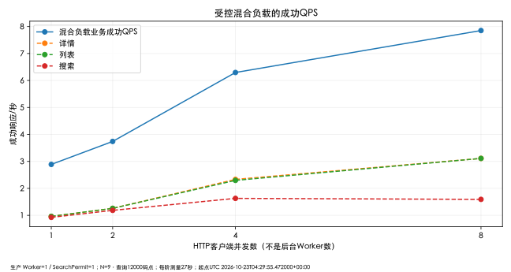
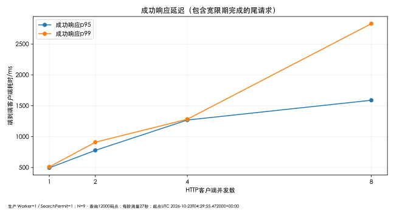
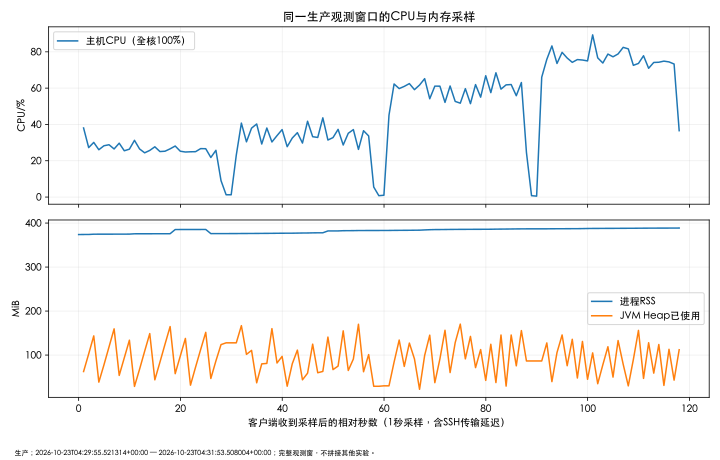

# 系统 QPS 性能基线报告（FINAL-QUALITY）

2026-10-23 在正式 HTTPS、真实认证和固定生产参数下完成一次有界阶梯实验。**本次混合负载最高观测成功 QPS 为 7.852；这是特定长查询、小候选集与短测量窗的结果，不能作为服务最大容量或 SLA。** Worker=2/4、N=100/1000/5000、独立环境极限吞吐均 `NOT_RUN`。

本报告是本轮新实测；既有 273 项自动化及 70 条主验收属于历史工程门禁，未拿来充当性能样本。功能覆盖见[线上功能报告](ONLINE-FUNCTIONAL-REPORT.md)，线程与一致性见[并发报告](CONCURRENCY-REPORT.md)。

## 环境与数据

| 项目 | 本轮实测或核对 |
| --- | --- |
| 生产版本 | 源码 `d016d6e8bb431ff17ba81f8977d31a1b96f51f7f` |
| 生产 JAR SHA-256 | `64bc9c0ba187b6779622a7ddab5beb4b50152424e3926c55b76249c98b609b50`，开测预检核对 |
| 公开开发基线 | `5f1740d2141473a7595eeb41eb6efb037a847815`，测试脚本和报告单独提交；未部署新构建包 |
| 服务端 | Ubuntu 24.04.5、Java 17、4 vCPU、约 8 GiB RAM / 40 GB SSD；Nginx HTTPS + Basic Auth、systemd、单 JVM / 单 H2 文件 |
| 默认参数 | Worker=1、Queue=64、SearchPermits=1、Hikari 最大连接数=4、CPU rounds=32；未调参 |
| 发压端 | 独立 Mac 客户端，10 逻辑 CPU、32 GiB；k6 v2.0.0，Go1.26.3 darwin/arm64，经系统 TLS 信任验证 |
| 候选与负载 | 开压前全库21篇，其中搜索渠道有效候选固定9篇；Top-K=1，查询12000 code points |
| 混合比例 | 详情 GET / 列表 GET / 搜索 POST 轮转；各阶段仅首迭代提交1篇，共4篇，走独立 ingest 渠道 |
| 时间 | 2026-10-23 12:29:55—12:31:53（北京时间）；首请求到末响应117.818秒 |

新提交不进入搜索渠道，四阶候选数一致。详情读取固定本轮文档，列表按本轮渠道查询、page=0/size=20。9是筛选后的候选规模，不是全库大小。测试结束后合计26篇（旧9 + 功能12 + 压力4 + Chrome1），本轮17/20篇写入预算；不删除或覆盖生产数据。

本机没有 Docker/Colima/Podman/Multipass，本轮未另建等价4核8G Linux环境。用户明确选择直接在正式服务短时阶梯升压，因此不在同机并行跑副本极限测试，也未扩大生产文档量。

## 窗口、预算与安全控制

用户授权上限为1/2/4/8并发、每阶30秒、总升压不超过120秒。单个 k6 进程配置每阶27秒发包、最多3秒 gracefulStop，阶段起点相隔30秒，总最大VU=8；没有额外30秒预热。测前单次认证 GET 只验证 TLS/客户端链路，不混入631样本。

开压前将客户端总上限从480搜索/960 GET调整为2400搜索/4800 GET，避免较快响应使预算提前耗尽；该调整已先告知并留独立时间记录，未改变并发或120秒上限。实际206搜索、421 GET、4提交，未触发客户端预算限制。所有写入结果未知均禁止自动重试。

只读守护采样要求 health 200、READY/businessReady；非就绪、异常5xx/未知写结果立即停。主机CPU>85%连续3点、可用RAM<2 GiB、磁盘<5 GiB、采样陈旧>4秒或客户端超时触发中止；单VU连续3个请求>2秒或至少20次搜索后拒绝率>95%亦中止。监督器只回收自己创建的客户端进程组与监控诊断子进程，不向生产 JVM 发信号。监控最大124秒，客户端控制器最大120秒；本轮所有 abortReasons 为空，没有再次加压。

统计口径：

- **成功QPS** = 每阶27秒半开窗内发起且完成的业务成功响应 / 27；200与校验合格的202分别记账，429不成功。202只代表接收，不代表向量化完成。
- **发起RPS** = 同一27秒窗内开始的请求 / 27。
- 延迟及“含尾部429”采用窗口内发起、在本阶段宽限期内完成的完整请求 cohort；不丢弃慢尾。另一列单独列27秒内完成的429，避免与QPS口径混淆。
- 延迟为客户端开始至收到响应的墙钟耗时，包含代理、HTTPS、网络和客户端等待；百分位用排序样本 `(n-1)` 线性插值。未伪称纯服务端执行时间。

## 阶梯实测

全轮631次：HTTP200×570、202×4、429×57；未知结果0、5xx0。业务成功响应574，成功搜索149/206；57次均明确 `SEARCH_BUSY`。总拒绝占全部请求9.03%，占搜索27.67%，不能混用分母。

| HTTP并发 | 窗口发起数 | 窗口完成成功数 | 成功QPS | 发起RPS | 429窗口内 / 含尾部 | 含尾部拒绝率（全部请求） | 5xx |
| --- | --- | --- | --- | --- | --- | --- | --- |
| 1 | 79 | 78 | 2.889 | 2.926 | 0 / 0 | 0.00% | 0 |
| 2 | 104 | 101 | 3.741 | 3.852 | 1 / 1 | 0.96% | 0 |
| 4 | 190 | 170 | 6.296 | 7.037 | 16 / 17 | 8.95% | 0 |
| 8 | 258 | 212 | 7.852 | 9.556 | 38 / 39 | 15.12% | 0 |



### 成功响应延迟（ms）

| 并发 | 样本数（含尾部） | 平均 | p50 | p90 | p95 | p99 | 最大 |
| --- | --- | --- | --- | --- | --- | --- | --- |
| 1 | 79 | 343.70 | 270.00 | 488.20 | 495.10 | 509.82 | 534.00 |
| 2 | 103 | 522.71 | 509.00 | 773.00 | 777.90 | 909.38 | 1040.00 |
| 4 | 173 | 584.09 | 521.00 | 1040.00 | 1269.00 | 1281.56 | 1372.00 |
| 8 | 219 | 815.22 | 509.00 | 1560.40 | 1589.20 | 2828.66 | 2903.00 |



### 各接口在同一混合负载中的结果

成功数、429和延迟保留cohort尾请求，QPS只计27秒内完成；submit每阶仅1样本，其百分位相同不具备容量推断意义。以下是混合分配下各接口的吞吐，不是对单接口独立加压的峰值。

| 并发 | 接口 | 发起 | 成功含尾部 | 429含尾部 | 发起RPS | 成功QPS | 平均ms | p50 | p90 | p95 | p99 | 最大 |
| --- | --- | --- | --- | --- | --- | --- | --- | --- | --- | --- | --- | --- |
| 1 | detail | 26 | 26 | 0 | 0.963 | 0.963 | 272.08 | 266.00 | 269.00 | 270.50 | 373.00 | 407.00 |
| 1 | list | 26 | 26 | 0 | 0.963 | 0.963 | 273.88 | 269.00 | 272.00 | 276.00 | 356.50 | 383.00 |
| 1 | search | 26 | 26 | 0 | 0.963 | 0.926 | 484.50 | 480.50 | 496.50 | 501.50 | 526.25 | 534.00 |
| 1 | submit | 1 | 1 | 0 | 0.037 | 0.037 | 360.00 | 360.00 | 360.00 | 360.00 | 360.00 | 360.00 |
| 2 | detail | 35 | 35 | 0 | 1.296 | 1.259 | 390.03 | 504.00 | 508.60 | 510.00 | 543.00 | 560.00 |
| 2 | list | 34 | 34 | 0 | 1.259 | 1.259 | 508.91 | 508.50 | 513.00 | 513.35 | 518.02 | 520.00 |
| 2 | search | 34 | 33 | 1 | 1.259 | 1.185 | 676.42 | 763.00 | 787.20 | 891.40 | 998.40 | 1040.00 |
| 2 | submit | 1 | 1 | 0 | 0.037 | 0.037 | 563.00 | 563.00 | 563.00 | 563.00 | 563.00 | 563.00 |
| 4 | detail | 64 | 64 | 0 | 2.370 | 2.333 | 477.27 | 514.50 | 756.70 | 764.85 | 863.74 | 865.00 |
| 4 | list | 63 | 63 | 0 | 2.333 | 2.296 | 487.10 | 521.00 | 758.00 | 759.90 | 762.00 | 762.00 |
| 4 | search | 62 | 45 | 17 | 2.296 | 1.630 | 865.53 | 1035.00 | 1275.60 | 1280.00 | 1332.84 | 1372.00 |
| 4 | submit | 1 | 1 | 0 | 0.037 | 0.037 | 867.00 | 867.00 | 867.00 | 867.00 | 867.00 | 867.00 |
| 8 | detail | 89 | 89 | 0 | 3.296 | 3.111 | 795.83 | 325.00 | 1562.20 | 1580.80 | 1591.24 | 1593.00 |
| 8 | list | 84 | 84 | 0 | 3.111 | 3.111 | 755.89 | 287.00 | 1539.40 | 1551.85 | 1576.34 | 1578.00 |
| 8 | search | 84 | 45 | 39 | 3.111 | 1.593 | 946.91 | 624.00 | 2639.00 | 2828.40 | 2875.28 | 2903.00 |
| 8 | submit | 1 | 1 | 0 | 0.037 | 0.037 | 1599.00 | 1599.00 | 1599.00 | 1599.00 | 1599.00 | 1599.00 |

## 资源与任务完成

119个约1Hz服务端采样覆盖整个观测窗（含少量启动/收尾）；客户端按收到采样时间对齐，含SSH传输延迟，未精密对时。曲线没有拼接其他实验。

| 指标 | 实测 / 边界 |
| --- | --- |
| 主机CPU采样峰 | 89.33%（全机全核100%口径）；>85%最大连续1点，未满足连续3点中止条件 |
| JVM进程CPU采样峰 | 98.99%（单核100%口径），约一核；不能把主机峰值全归因于应用，未分解其他进程或steal |
| RSS峰 / Heap已用峰 | 388.70 MiB / 170.32 MiB |
| 最低可用RAM / 磁盘余量 | 6.30 GiB / 32.75 GiB |
| GC累计增量 | YGC +41、YGCT +0.186秒；GCT +0.185秒，FGC/CGC均+0；jstat字段独立舍入，非逐事件暂停记录 |
| GC单次暂停 | `NOT_MEASURED`，不以累计GCT代替pause事件 |
| Worker | 始终观察到1条；4任务最终SUCCEEDED，持久处理时间区间最大重叠1 |
| 队列与连接池 | 精确执行器队列长度、Hikari active/idle/awaiting与等待时长均 `NOT_MEASURED`；单点未见借用等待不能换算为0ms |
| 发压进程 | 231个ps观测点，CPU观测峰4.2%、RSS峰45.83 MiB；不是精密区间CPU或全机指标 |



四篇处理耗时217.508 / 246.152 / 406.123 / 390.229 ms，排队等待75.541 / 384.031 / 105.443 / 407.295 ms。四篇/120秒=0.03333 documents/s，只是稀疏混合输入完成率；每阶仅一篇，不是Worker处理能力上限。数据库时间戳用于观测处理区间，不能当精密CPU活跃时间。

## 结果分析与未完成项

- 默认参数下，本轮成功混合QPS从2.889升至7.852。详情、列表吞吐随客户端并发增加；搜索窗口成功QPS为0.926 / 1.185 / 1.630 / 1.593。4到8并发时搜索吞吐不再上升，同时搜索拒绝从17/62升至39/84（均含尾部）。这证明该场景搜索许可开始形成可见保护边界，不能推断全系统最大容量。
- 首次429出现在2并发；8并发成功p99达2828.66ms。无需为追求16/32并发继续给正式服务升压。结束后5个核账GET、Chrome闭环和最终1GET审计成功，确认保护后可恢复正常业务；不是持续高负载耐久测试。
- 观察到一个Worker的真实CPU活动，输入稀疏且没有任务积压实验，不能判定Worker为瓶颈。H2及连接池没有精确占用/等待证据，不能下结论为瓶颈或无瓶颈。
- k6进程没有观测到明显CPU/RSS饱和；公网RTT、客户端排队、主机其他负载没有逐项隔离，不能据此给出纯服务端性能归因。p99来自短窗小样本，也不是长期SLA。
- Worker=2/4收益、N=100/1000/5000与Top-K规模曲线、队列极限、大量QUEUED、单接口独立饱和吞吐均未执行。需要独立Linux资源/重建数据集才能公平补测；不能在现有17/20预算与冻结生产参数下冒充完成。
- 当前证据支持小规模演示、受控短时混合访问及429保护；生产容量边界仍为最多5000文档，但没有测得该规模QPS。优化建议仅限后续实验设计：独立机器、连接池/队列只读gauge、固定候选规模/输入、重复窗口与网络基线；本轮没有修改生产。

| 场景 | 本轮状态 |
| --- | --- |
| P01详情 / P02列表 | `MEASURED_IN_MIX`，不是单接口峰值 |
| P03提交接收 / P04完成吞吐 | `PARTIAL`，4篇稀疏输入，不是容量试验 |
| P05搜索 / P07保护恢复 / P08混合 | `MEASURED_WITH_LIMITATIONS`，参数与窗口见上 |
| P06候选量与Top-K / P09 Worker对比 / P10规模QPS | `NOT_RUN`，不沿用历史组件微基准代替 |

## 脚本与复核

公开脚本在 [tests/performance](../../tests/performance/)：`functional_runner.py`、`production-baseline.js`、`guarded_run.py`、`verify_counters.py`、`analyze_baseline.py`。认证必须由操作者放在项目外受限0600文件，通过 `QUALITY_CREDENTIALS_FILE` 指定路径；秘密不进入命令参数、日志或Git。k6同时要求 `QUALITY_AUTHORIZED_LIVE=YES`，配置包括HTTPS origin、本轮唯一runPrefix/channel、批准JAR摘要；这些开关不能替代真实用户授权。

离线复核命令（不向正式服务发请求）：

```bash
python3 tests/performance/functional_runner.py --self-test
python3 tests/performance/analyze_baseline.py --self-test
python3 tests/performance/analyze_baseline.py \
  --console "$EVIDENCE/pressure-results/console.jsonl" \
  --metrics "$EVIDENCE/pressure-results/metrics.jsonl" \
  --monitor "$EVIDENCE/pressure-control/monitor.jsonl" \
  --controller-result "$EVIDENCE/pressure-control/controller-result.json" \
  --counter-audit "$EVIDENCE/pressure-audit/counter-audit.json" \
  --client-resources "$EVIDENCE/pressure-control/client-resources.jsonl" \
  --output-dir "$NEW_OUTPUT"
```

`EVIDENCE`为操作者已获授权的受限证据目录，`NEW_OUTPUT`必须不存在；不把它们当公开下载地址。制图需要本地matplotlib与支持中文的字体，必要时用 `--font-file` 指定。首次制图发现中文缺字，改用已安装中文字体后重生成且目检4图；保留旧派生图，不改原始统计。分析器独立测试了半开窗口、尾部429和百分位边界。只对自己启动的本地客户端做过守护器异常收尾夹具测试，没有对生产注入故障。

独立评审发现分析器原先未拒绝提前中止或超出3秒收尾的数据，已补齐控制器/计数核账PASS、四阶完整起点、27秒发起/30秒结束及异常结果门禁，并以离线反例核证拒绝。新门禁重新处理本次真实数据通过，聚合字节完全一致，没有重复发压。Python编译、自测、k6离线inspect（maxVUs=8、总2分钟）和Mermaid语法验证均实际执行；首次本机编译缓存路径受限与inspect未继承环境的工具错误已纠正，不作为线上失败。

本轮没有替换生产JAR、重新部署或重启服务。服务器Owner在北京时间12:51:23再次只读核对原版本、Java17、单JVM/H2、应用与Nginx active/enabled且重启计数0、health200/六项true；本轮日志时间窗未发现新增WARN/ERROR（journal无新行，不代表全部历史日志无错）。该最终报告SHA `b76c95fae44e6cbb9abc4c3c1cd219d2f0e3e29e88221613ad019bd4174f74e3`，原件仍受限。本轮临时本机0600认证副本及空临时目录均已移除，服务器原凭据未动。

收尾本地Java17完整 `clean verify` 已重新执行：104 Unit + 126 IT通过；Node另43通过，失败/错误/跳过均0。首次沙箱禁止随机回环端口导致7个启动错误，原件保留，允许端口后全量重跑成功。它们是工程回归，不并入631次线上样本。日志SHA `25a4ef9e8d8104871fa5eeabaf16c76ef68e8c9c2372ab308e108abaf1e5acf2`。

提交 `30eaf54d663f1ee061f17fba6b6add12a40fa2ef` 对应 [CI39903497011](https://github.com/Qbsstg/text-vector-search/actions/runs/39903497011) 已于2026-10-23 13:03:46北京时间实际Success：104 Unit、126 IT、43 Node，以及批准原JAR核对、Linux隔离冷备恢复/单实例门禁通过。CI原始日志SHA `cd246aafd1e69b72592d1b488c57239706187af0977a48dae2090e15eeb7e39c`，受限本地保留。这是工程回归，不能给未执行的规模/Worker性能组填PASS；CI新构建产物未部署。

推送后已在真实Chrome核读GitHub首页新摘要、三份报告导航和四张公开SVG图像加载。README原生Mermaid经本地11.12.1解析为flowchart-v2，但本轮自动化Chrome中的GitHub iframe加载后出现 `Unable to render rich display`；仅在未提交的编辑器临时预览最小 `graph TD; A-->B;` 也有同样结果，随后已取消草稿，未改公开内容。没有证据将其归因为项目图表语法错误；**GitHub原生Mermaid实际渲染验收仍未通过，保留待人工核证**，不以语法检查或SVG性能图替代。当时已发出正常Chrome复核请求，尚未取得结果。本轮其余受控生产结果已交付，完整FINAL-QUALITY仍包含上述规模、Worker和观测缺口，不标全项DONE。

### 架构展示后续核证（2026-10-23）

用户随后确认普通Chrome同样加载失败，原始失败结论保留。15时许在内置浏览器重新打开同一GitHub页面，原生Mermaid iframe实际出现Render文档与完整diagram节点，并经截图目检；这证明GitHub能解析该图，不能据此前失败认定图表语法缺陷，也不能把内置浏览器结果当成用户Chrome已恢复。具体加载失败根因仍未确定，未修改用户浏览器设置。

README已增加仓库内的[静态架构总览](../design/system-architecture.svg)，默认直接展示，原生Mermaid移入可展开区域。Mermaid源文本SHA仍为 `ea0299e9ff11eb951fc9cae00de49651f3e9c62925c6341a4f53f1a702aaabc8`，与修复前逐字相同；静态图按同一源码与冻结资源约束绘制，不包含脚本、外链资源、认证或内部运维路径。

本轮实际检查：SVG XML有效；19个节点的标题/正文在真实浏览器内均未溢出边框；GitHub首页静态图加载完整（1440×1370），默认折叠的原生图展开后在内置浏览器真实渲染，再恢复折叠。只记录静态展示可用与该浏览器下原生渲染通过，普通Chrome原生渲染仍未核证恢复。原始截图和AX保留受限本地，不上传公开仓库。该修复仅涉及文档，未操作生产服务、认证、数据库或压测；并行前端主线采用正常合并保留，未改写历史。

## 受限原件索引

仅公开逻辑名与SHA，完整载荷、截图、线程/运维明细继续受限保存。下列SHA只能定位原件，不让第三方仅凭汇总重建所有原始行；图表是派生聚合。

| 逻辑原件 | SHA-256 |
| --- | --- |
| `pressure-results/console.jsonl` | `32986415b2172f73ef9beb07232af1736d1ee3e7b2cf79a18a055b0849ee7f49` |
| `pressure-results/metrics.jsonl` | `f96756f10b0bd03799d526bbce16d5b8898bad2685aded79ee64835e7959c4f5` |
| `pressure-control/monitor.jsonl` | `3e6ec3ff745ee00ca5711c3cfe8fd2fc0451422b69263689fd9abe26e1ef84d2` |
| `pressure-control/controller-result.json` | `c29f62407c013b9a9e1b70a09cff4e2e009011cbcbeac98967640716c116a374` |
| `pressure-control/client-resources.jsonl` | `9a3623b8eef797c1993083d5757427a6771eae22a5586ab243a55265c6efb44e` |
| `pressure-audit/counter-audit.json` | `144499290d69b26bc370c5a5bc739fd08e7e78263a422156040ba1aa3caaaeb0` |
| `analysis-published/aggregate.json` | `2dfe934a51fd1c49b69c452bdc9b07087ebdf1f4e22267460f23187efe7ddd75` |
| `final-audit.json` | `eae95ec4a1502699bc120bf58e3a0cceff5112d1ff17312dac5826d8310e2fc0` |
